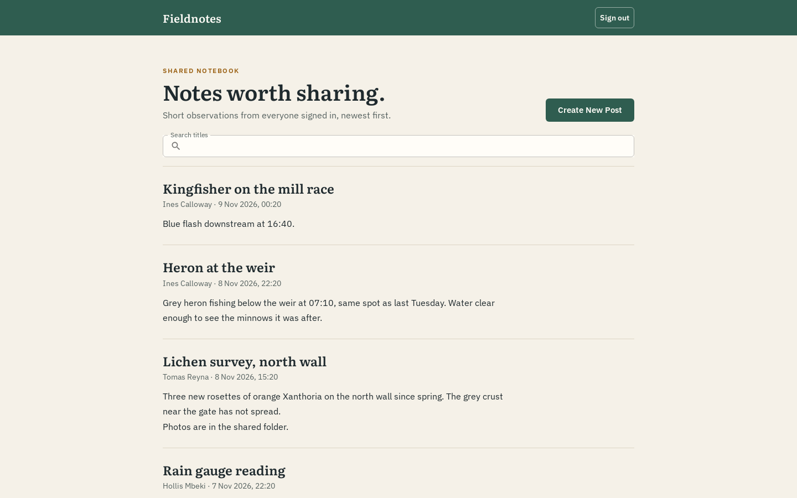
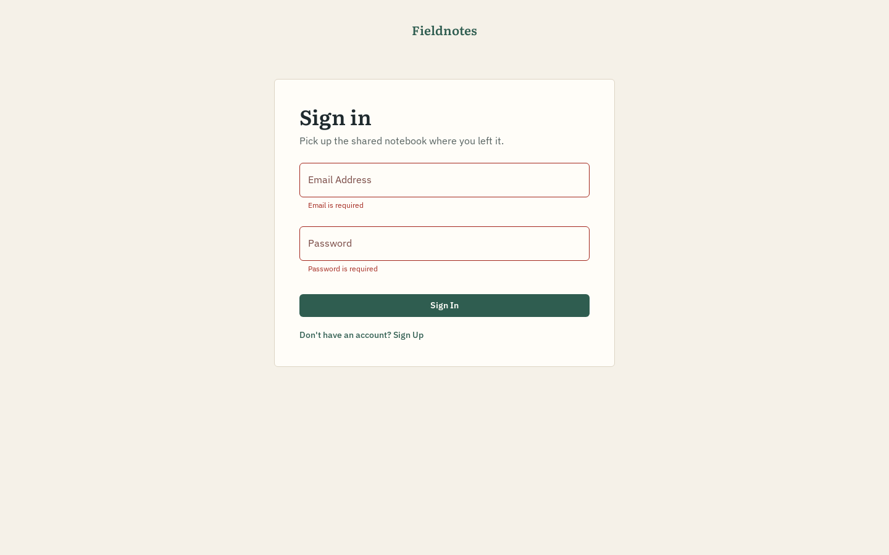
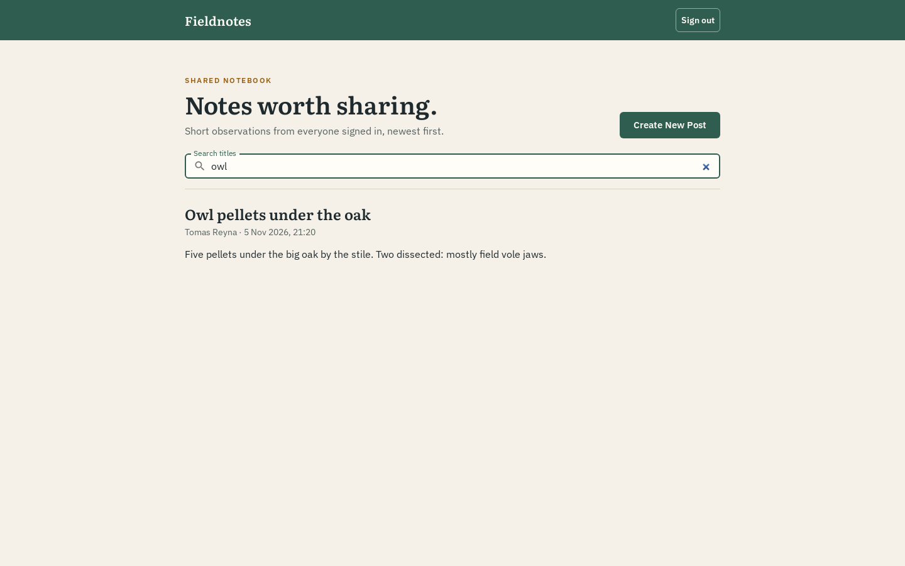
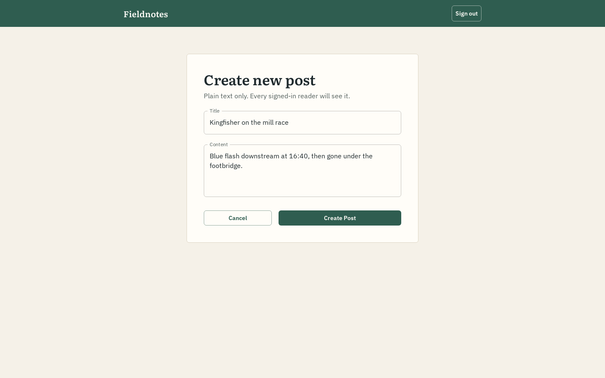
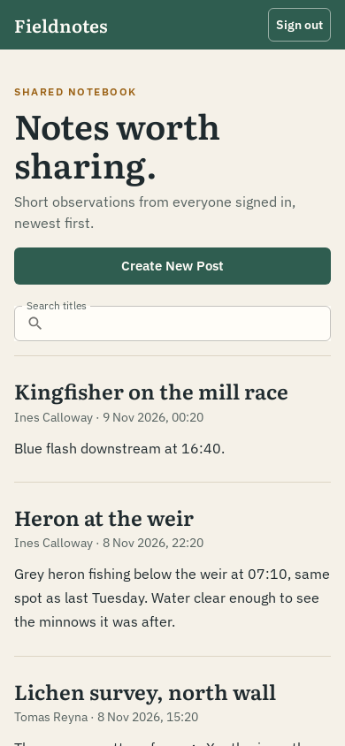
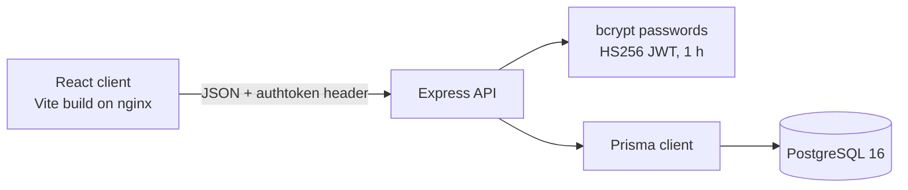

# Fieldnotes: shared blog feed

A small full-stack text-publishing exercise: an Express + Prisma + PostgreSQL API and a React + Material UI client. People sign up, sign in, read one shared feed of short notes (newest first, searchable by title) and add their own. There is no private workspace, editing or deleting, comments, or publishing workflow; the point is a compact, well-tested account-and-feed loop.



| Sign in (validation) | Title search | New post | Phone, 390 px |
| --- | --- | --- | --- |
|  |  |  |  |

Screenshots come from the Docker Compose stack below with the demo seed: every author and note is fictional.

## Repository layout

| Path | What it is |
| --- | --- |
| `blogs-server-main/` | Express 4 API, Prisma 6 schema and migrations, node:test suites. Installed with **npm**. |
| `blogs-web-main/` | React 18 + MUI 5 client built with Vite, tested with Vitest. Installed with **Yarn 1**. |
| `docker-compose.yml` | PostgreSQL 16, the API and an nginx-served web build. |

The two packages keep their own lockfiles; the root `package.json` only holds convenience scripts. This monorepo overlaps the separate blog API/reader repositories and should not be presented as three independent portfolio achievements.



## Run it with Docker Compose

Requires Docker with Compose v2.

```sh
cp .env.example .env
# put two random values in .env, for example from: openssl rand -hex 32
#   POSTGRES_PASSWORD=...
#   JWT_KEY=...            (at least 32 characters)
docker compose up -d --build --wait
docker compose exec api npx prisma db seed   # optional demo data
```

- Web app: <http://localhost:3000>
- API: <http://localhost:8080/api> (health check at `/api/health`)

The API container applies migrations on start. The seed creates three fictional authors (`ines.calloway@example.com`, `tomas.reyna@example.com`, `hollis.mbeki@example.com`) sharing the demo password `fieldnotes-demo` (override with `SEED_PASSWORD`), and does nothing if the database already has users. Both ports bind to 127.0.0.1 only. Stop with `docker compose down`; add `-v` to drop the database volume.

## Run the packages directly

Use Node 22.12 or newer (`.nvmrc`), npm, Yarn 1 and a PostgreSQL database you can write to.

```sh
cd blogs-server-main
npm ci --ignore-scripts
cp .env.example .env          # set DATABASE_URL and a 32+ character JWT_KEY
npx prisma generate
npx prisma migrate deploy
npx prisma db seed            # optional
npm run dev                   # ts-node via nodemon on 127.0.0.1:8080
```

```sh
cd blogs-web-main
yarn install --frozen-lockfile --ignore-scripts
cp .env.example .env          # REACT_APP_API_URL, defaults to http://localhost:8080/api
yarn start                    # http://localhost:3000
```

`npm run build && npm start` runs the compiled API from `dist/`; `yarn build` writes the static client to `build/`. The API only accepts browser requests from `REACT_APP_URL` (default `http://localhost:3000`).

## API

All responses use one envelope: `{ "payload": ..., "message"?: "..." }`. Post routes need the token from login in a custom `authtoken` header. Captured from the Compose stack:

```http
POST /api/auth/login
{"email":"Ines.Calloway@example.com","password":"fieldnotes-demo"}

200 {"payload":{"authtoken":"eyJhbGciOiJIUzI1NiIs..."}}
```

```http
POST /api/posts
authtoken: <token>
{"title":"Kingfisher on the mill race","content":"Blue flash downstream at 16:40."}

200 {"payload":{"id":"d0db34d9-e3d6-44b4-99d9-3f19bb96f3c6","title":"Kingfisher on the mill race",
     "content":"Blue flash downstream at 16:40.","createdAt":"2026-11-09T00:20:18.201Z",
     "author":{"name":"Ines Calloway"}}}
```

```http
GET /api/posts?title=heron
authtoken: <token>

200 {"payload":[{"id":"4747c819-...","title":"Heron at the weir","content":"Grey heron fishing below the weir...",
     "createdAt":"2026-11-08T22:20:17.910Z","author":{"name":"Ines Calloway"}}]}
```

| Request | Result |
| --- | --- |
| `POST /api/auth/signup` with `name`, `email`, `password` | `200`, or `409 User already exists` (emails compare case-insensitively) |
| `POST /api/auth/login` with a missing field | `400 password is a required field` |
| `GET /api/posts` without a token | `401 Unauthorized user` |
| Unknown route or malformed JSON | `404 Not found` / `400 Invalid request`, still JSON |

`GET /api/posts` returns at most the 50 newest posts and exposes only the author's name.

## Design notes

- **Validation in one place per side.** Yup schemas on the API trim and lower-case input before it reaches Prisma; the client schemas mirror the same limits (name 3+, password 8 to 72 characters because bcrypt ignores bytes past 72, title 3 to 200).
- **The database enforces uniqueness.** Signup relies on the unique email index and maps Prisma's `P2002` to `409`, so two simultaneous signups cannot both succeed.
- **Login costs the same either way.** An unknown email is still compared against a throwaway bcrypt hash, so response time does not reveal which emails have accounts.
- **Tokens are short-lived and strictly checked.** HS256 only, one-hour expiry, a payload that must carry a user id, and a server that refuses to start with a signing key under 32 characters. A token whose account has disappeared gets `401` when posting.
- **The client re-reads the cookie on every request**, signs out on any `401`, and treats the cookie only as a navigation hint; the API is the authority.

## Tests

| Command | Where it runs | What it covers |
| --- | --- | --- |
| `npm run test:unit` (API) | no database | validation schemas, JWT boundaries, 404/400/CORS handling |
| `npm run test:integration` (API) | `TEST_DATABASE_URL` | hashing, duplicate and concurrent signups, login failures, feed order and fields, search, the 50-post cap, health check |
| `yarn test` (web) | jsdom | forms, the axios request hook, feed loading/empty/error/401 states, search |

The integration suite **deletes every row** in the database named by `TEST_DATABASE_URL` and applies migrations to it first, so point it at a throwaway database. `npm run lint`, `npm run typecheck` and `npm run format:check` (API) and `yarn lint` (web) are the static checks.

## Known limits

- Sessions are a JavaScript-readable cookie holding the JWT (`SameSite=Strict`, `Secure` on HTTPS, one hour). Sign-out is local; a copied token stays valid until it expires.
- No rate limiting, pagination beyond the newest 50, password reset or email verification.
- The remaining audit findings are in development tooling only: the Prisma CLI's config loader (deepmerge-ts), typescript-eslint/nodemon (minimatch) and six moderate findings in the web toolchain.

## License

MIT, see [LICENSE](LICENSE).
