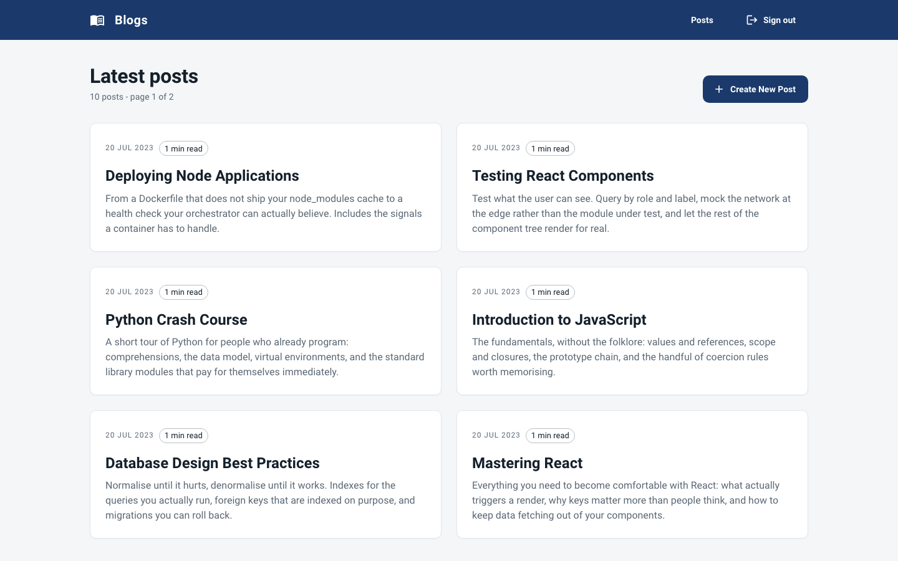

# blogs-web

React client for a small blog API (blogs-server). You can sign up, sign in, browse a paginated feed of posts and publish your own. Written in TypeScript on Create React App with Material UI.



What's in it:

- Sign up and sign in forms with Yup validation
- Post feed, 6 posts per page, with loading skeletons, an error state with retry, and an empty state
- New post editor
- Token kept in a cookie behind a small `TokenStore` interface (`src/services/tokenStore.ts`), with an in-memory version used in tests
- Any 401 response clears the token and sends you back to sign in

## Running locally

You don't need the real backend to try it. `scripts/mockApi.mjs` is a small Node server that mimics the API and seeds ten posts.

```bash
yarn install

# terminal 1
yarn mock-api

# terminal 2
REACT_APP_API_URL=http://localhost:8591/api yarn start
```

Open http://localhost:3000 and sign in with `johndoe@example.com` / `abcd1234`.

To use the real blogs-server instead, point `REACT_APP_API_URL` at it (for example `http://localhost:8080/api`) and add this app's origin to the server's `CORS_ORIGINS`.

### Config

- `REACT_APP_API_URL`: API base URL including `/api`. Defaults to same-origin `/api`.
- `PORT`: dev server port, 3000 by default.
- `WEB_PORT`: host port used by `docker-compose.yml`, 8590 by default.

These are baked into the bundle at build time, so don't put secrets in them.

## API calls

| Method | Path | Used by |
| --- | --- | --- |
| POST | `/api/auth/signup` | sign up form |
| POST | `/api/auth/login` | sign in form |
| GET | `/api/posts?page=&limit=` | feed |
| POST | `/api/posts` | editor |

Requests send the token as both `authtoken` and `Authorization: Bearer`.

## Scripts

```bash
yarn test:ci      # run tests once
yarn coverage     # tests with coverage
yarn lint
yarn typecheck
yarn build
```

Tests mock axios (`src/__mocks__/axios.js`) so nothing hits the network.

## Docker

There's a multi-stage `Dockerfile` that builds the app and serves it with nginx on port 8080 (config in `docker/nginx.conf`), and a `docker-compose.yml` that publishes it on 8590.

## Todo

- Cards don't show author names because the API only returns `authorId`.
- No edit, delete or single post page yet (the API doesn't support them).
- Move off Create React App to Vite.
